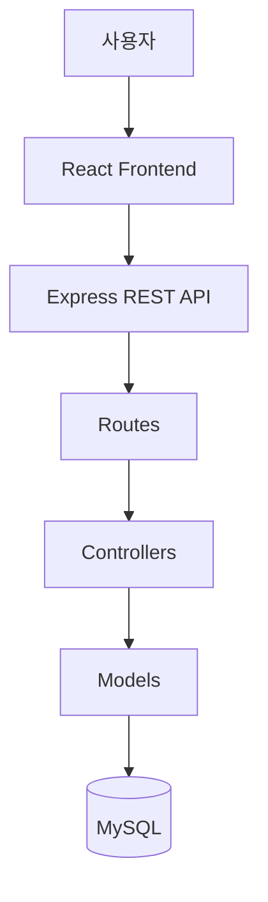

# 시스템 아키텍처

## 1. 시스템 구성

- Frontend: React
- Backend: Express
- Database: MySQL

## 2. 아키텍처

## 3. 계층별 책임

| 계층        | 책임                            |
| ----------- | ------------------------------- |
| Frontend    | 화면 렌더링 및 사용자 입력 처리 |
| Routes      | API 경로와 컨트롤러 연결        |
| Controllers | 요청 검증 및 응답 처리          |
| Models      | SQL 쿼리 및 데이터 접근         |
| MySQL       | 데이터 영속성 관리              |

## 4. 기술 선택 근거

각 기술을 선택한 이유와 적용 범위를 작성합니다.

## 5. 요청 처리 흐름

1. 사용자가 프론트엔드에서 요청합니다.
2. Express가 요청을 수신합니다.
3. Route가 해당 Controller로 요청을 전달합니다.
4. Controller가 Model을 통해 데이터를 처리합니다.
5. 결과를 JSON 응답으로 반환합니다.
