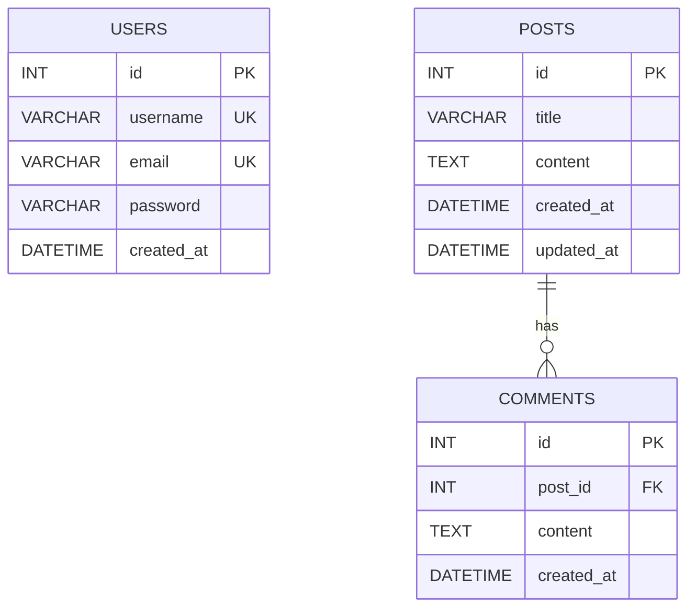

# ERD 및 데이터베이스 설계

## 1. ERD

## 2. 테이블 설명

### USERS

- 사용자 식별자
- 사용자명
- 이메일
- 비밀번호 해시
- 생성 일시

### POSTS

- 게시글 식별자
- 제목 및 본문
- 생성 및 수정 일시

### COMMENTS

- 댓글 식별자
- 소속 게시글 ID
- 댓글 본문
- 생성 일시

## 3. 테이블 관계 및 제약조건

- 게시글과 댓글은 1:N 관계입니다.
- 게시글 삭제 시 댓글도 함께 삭제되도록 설정합니다.
- 사용자명과 이메일의 UNIQUE 제약조건을 적용합니다.

## 4. 원본 스키마

실제 테이블 정의는 `server/db/schema.sql`을 기준으로 합니다.
